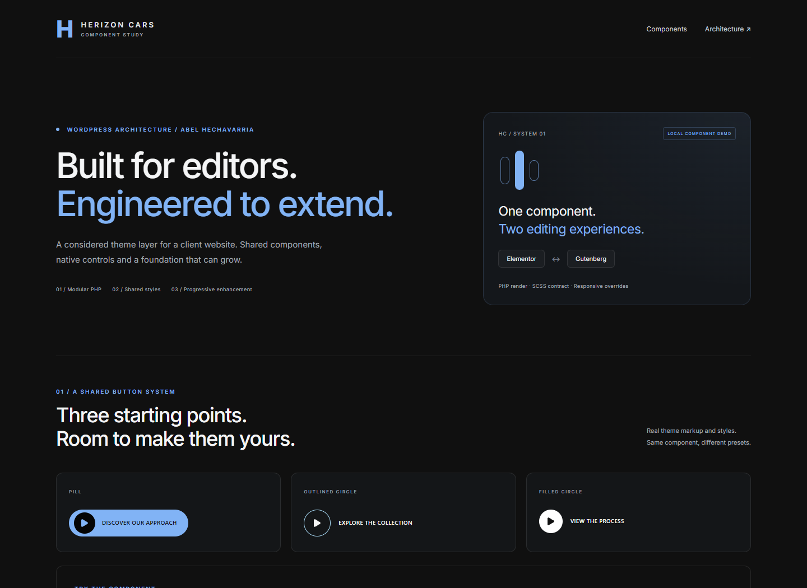
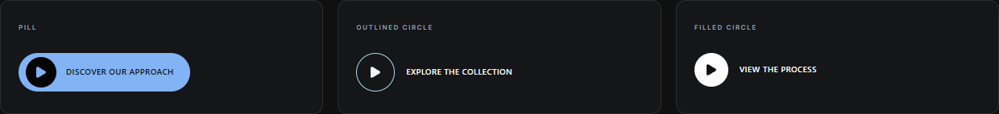

# Herizon Cars

**A modular WordPress child theme with reusable components for Elementor and the block editor.**

Client project by **Abel Hechavarria** · WordPress architecture, PHP, JavaScript and SCSS.

The brief: keep content editable in Elementor while giving the website a maintainable home for custom functionality. The result combines a modular theme layer, a shared button system across two editors, selective frontend effects and a reproducible asset pipeline.



[Case study](docs/portfolio/case-study.md) · [Architecture](docs/portfolio/architecture.md) · [Verification](docs/portfolio/verification.md) · [Demo instructions](#try-the-demo)

[](https://github.com/abel-hechavarria/herizon-cars/actions/workflows/quality.yml)

[Releases / installation ZIP](https://github.com/abel-hechavarria/herizon-cars/releases) · [Client update workflow](docs/releasing.md)

## What I built

| Area | Implementation |
|---|---|
| Theme architecture | Hello Elementor child theme; a small bootstrap and explicit modules with settings and execution conditions. |
| Editing experience | Four native Elementor widgets: HCars Button, logo marquee, text marquee and expandable gallery. A separate API v3 Gutenberg button block. |
| Shared component system | Three button variants, one PHP renderer, one SCSS component and a generated design contract. Normal/hover states, responsive overrides, SVG icons and explicit style reset. |
| Frontend behavior | Optional preloader, decorative cursor, smooth scrolling, back-to-top and configurable contact panel, coordinated through a shared runtime. |
| Defensive integration | Capability checks, validated settings, context-aware execution, typed CSS values, SVG sanitization and conservative upload handling. |
| Delivery | Versioned GitHub Releases and native WordPress update discovery; pinned pnpm dependencies, Vite manifest, locally served assets, regression tests, Hungarian translations and developer documentation. |

My scope covers custom theme architecture, component adaptation, editor integration, validation and handoff. Hello Elementor and Elementor provide the parent theme and visual editor. Selected interactions were adapted from my existing component library; third-party libraries retain their attribution. [Decisions and provenance](docs/portfolio/case-study.md).

## Start with the shared button system

HCars Button demonstrates how I keep two editing interfaces aligned without duplicating frontend implementations:

1. [Generate a shared schema](scripts/button-assets.mjs) for presets and style properties.
2. [Normalize and render in PHP](inc/components/button.php), including safe links, typed values and SVG handling.
3. Expose the contract through [Elementor controls](inc/widgets/class-widget-button.php) and a [Gutenberg inspector](src/js/button-editor.jsx).
4. Apply [the same SCSS component](src/scss/components/_button.scss) to frontend and editor previews.

The frontend button requires no animation JavaScript. Without a destination it renders a non-navigating preview. The block also saves a text/link fallback, so removing the theme does not discard that content.



## Try the demo

The demo uses actual PHP-rendered components and compiled theme styles, with original placeholder illustrations and fictional marks. It is a component study, not the client's live website or its production pages.

From the repository root:

```sh
python -m http.server 8080
```

Open `http://localhost:8080/docs/portfolio/demo/`. Try the variants and icons, keyboard focus, text-marquee pause and gallery. The small preview-control script belongs to the demo; it is not a frontend dependency of HCars Button.

## Build and test

Requirements: PHP 8.2+ with DOM/XML and zlib; Node.js 22.12+; pnpm 11.25.0. WordPress 6.5+ and Hello Elementor are required to install the theme. Elementor is required for its widgets; the independent button block does not require Elementor to register. Elementor Pro is used by the client site and is not included here.

```sh
pnpm install --frozen-lockfile
pnpm lint
pnpm test
pnpm build
pnpm dev       # rebuild on changes
pnpm package   # installable ZIP under build/
```

Standalone tests run without a WordPress database. Native editor/frontend integration was also checked inside WordPress. A GitHub Actions checks lint, tests and build. The badge above links to the current hosted result.

For installation, place the `herizon-cars` folder in `wp-content/themes/`, keep Hello Elementor installed and activate the child theme. Configure modules in **Appearance → Herizon Cars**. Contact channels start empty. [Development guide](docs/portfolio/development.md).

## Scope and evidence

This repository showcases client-theme engineering: source, compiled assets, tests and a synthetic demo. WordPress core, commercial plugins, client media, page exports, database content and production credentials are not included.

Local checks cover input boundaries, persistence in both editors, frontend states, reduced motion and selected responsive viewports. Production deployment, business results, performance scores and full accessibility certification are not claimed. [Evidence and limitations](docs/portfolio/verification.md).

## Attribution and licenses

Original theme source declares **GPL-2.0-or-later**; the GPL text is provided in [LICENSE](LICENSE). Bundled dependencies retain their separate notices: GSAP/ScrollTrigger, Lenis and Font Awesome Free. See [third-party notices](THIRD-PARTY-NOTICES.txt) and the [Font Awesome license](assets/licenses/fontawesome-free-LICENSE.txt). Client branding and media are not relicensed by this repository.

## Customer update workflow

Develop and test in LocalWP, commit and push source, then publish an explicit stable version tag when ready. Its workflow builds the installation ZIP and publishes a GitHub Release. Active installations of version 1.2.0 or newer discover that release through WordPress’s native update screen; the administrator chooses when to install. A source commit alone does not announce an update. [Release and maintenance guide](docs/releasing.md).
