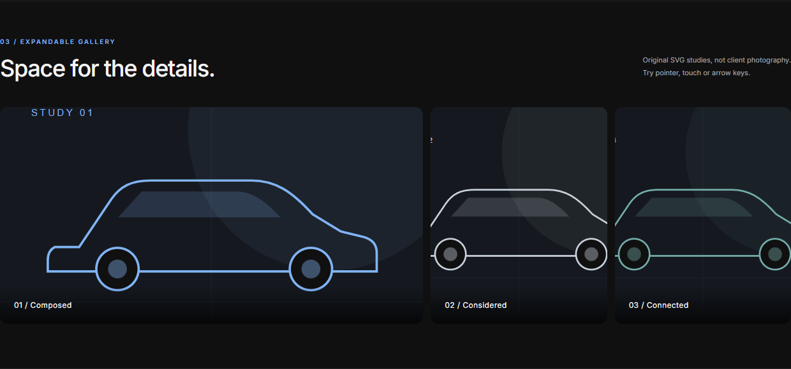

# Case study: a client theme that can grow

**Herizon Cars** · **Abel Hechavarria** · WordPress architecture and reusable editor components.

## The brief

The client website uses Hello Elementor and Elementor Pro. Custom functionality needed a clear home without making everyday editing dependent on changes to PHP templates. The visual direction called for a dark background and restrained motion, with controls that remain useful to the person editing the site.

The challenge was to keep builder-driven content and custom code working together: configurable global effects, repeatable widgets, predictable asset loading and safe defaults.

## My contribution

I structured the custom child theme, adapted selected components from my existing WordPress library, integrated native editor controls and added validation and regression coverage. The work includes a modular bootstrap, independent feature settings, four Elementor widgets, a Gutenberg button block, shared PHP/SCSS, translations and reproducible packaging.

Hello Elementor supplies the parent theme; Elementor supplies the editor. GSAP, Lenis and Font Awesome are third-party dependencies. The work presented here is the custom architecture and integration, including changes needed to make reused interactions independent of their original site.

## Three decisions worth discussing

### Preserve the editorial workflow

A child theme extends Hello Elementor while keeping page composition in the builder. The active kit supplies applicable font/color variables, with a `#101010` background fallback. Fluid typography is opt-in through utility classes, so the theme does not force a redesign of existing documents.

This deliberately retains a dependency on the parent and builder. Future business functionality that needs to survive a theme change should move to a plugin.

### Share the button contract across editors

The brief included three related button variants, with detailed controls in Elementor and Gutenberg. Maintaining independent frontend components would make defaults and fixes drift.

A generated schema describes presets and typed fields. Both editors expose that contract; PHP validates and renders saved values. Shared SCSS resolves responsive and hover overrides. Switching a variant keeps explicit customizations; reset restores its design without deleting content or the icon choice.

Editor previews still use their respective APIs, so parity requires real save/duplicate/reload checks. The Gutenberg block also stores a text/link fallback for use without the theme.

### Let animation fail safely

Effects use shared lifecycle/state. Disabling the contact panel does not break footer-aware back-to-top or blur. The preloader starts hidden and only blocks scroll after initialization, with bounded cleanup. Device conditions and reduced-motion preferences can prevent effects from starting.

Content and links remain available without decorative JavaScript. These are implementation choices, not a claim of complete accessibility conformance.

## Evidence and boundaries

Local validation includes PHP/JavaScript regressions, native editor persistence, repeated rendering, SVG/link/CSS input boundaries, focus, no-JavaScript output and selected viewports. The [verification record](verification.md) separates standalone tests, WordPress runtime evidence and browser checks.

The outcome demonstrated is a working custom theme layer and documented validation. No conversion lift, traffic increase, production audit or independently certified performance/accessibility score is claimed.

## Reuse and provenance

Selected preloader, cursor, scrolling, marquee, gallery and typography patterns originated in my earlier theme/component work. Their adaptation removes site-specific data and portfolio/ACF dependencies, adds independent settings and tightens lifecycle/fallback behavior. The Vite manifest approach builds on earlier theme tooling.

HCars Button adds the cross-editor contract, renderer, responsive styles and local icon integration. Dependency notices are retained. The demo uses illustrations and placeholder marks created for this showcase; it does not bundle client photos or page exports.
